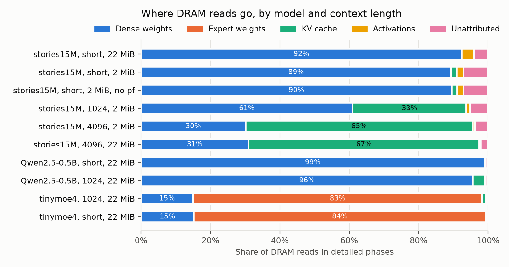
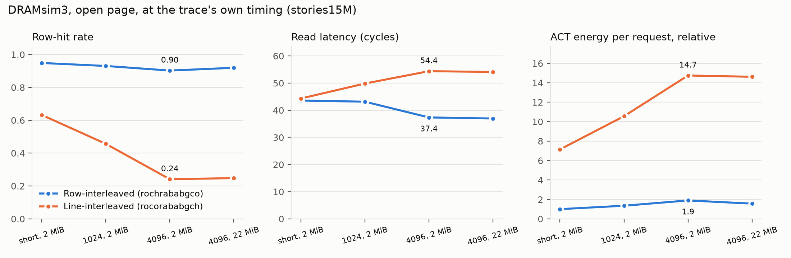
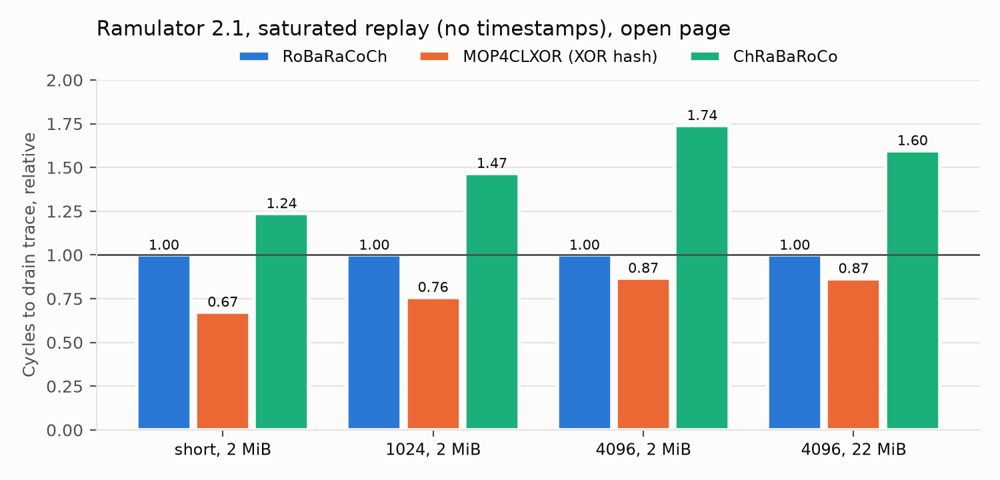

# Analysis of experiments to date

Authors: Aditya Samineni, Prasanna N R. Written 2026-11-03.

Every number here comes from `analysis/tables.md`, which `trace-pipeline/tools/report.py` generates from the per-run result files in `cluster-data/results/`. The figures are in `analysis/`. Rebuild both with:

```bash
python3 trace-pipeline/tools/report.py cluster-data/results analysis
```

## Summary

- **The capture pipeline is validated.** All 9 gem5 runs reproduce native llama.cpp's generated text, and in every detailed phase the trace's request counts equal gem5's controller counters.
- **Decode streams the whole model through DRAM on every token.** On Qwen2.5-0.5B, weights are 96–99% of DRAM reads, and each token reads about the full 330 MiB of weights once. The LLC gives no reuse.
- **KV traffic is large only when weights are small.** It reaches 66% of reads on the 15M-parameter model at 4096 tokens, but only 3.5% on Qwen at 1024 tokens. A simple model below gives the context-times-batch at which KV catches up with weights.
- **The MoE model used so far has no routing behaviour.** `tinymoe4` has 2 experts and uses both on every token.
- **Row-buffer locality is already high.** gem5 row-hit rates are 0.88–0.93. Streams are mostly sequential.
- **The traces exercise only 1–1.8% of one DDR4 channel's bandwidth.** At that load, mapping barely changes latency. Under saturated replay, an XOR bank hash finishes 13–33% sooner than row interleaving, despite a much lower hit rate. Real CPU inference is bandwidth-bound, so the saturated regime is the one that matters, and the current traces cannot show it at their own timing.
- **Consequence for the next phase:** a publishable study needs traces from optimized, multi-threaded inference of full-size models, replayed closed-loop. The gem5 SSE2 single-core setup cannot provide this at that scale. It remains useful as the validation reference.

## Setup

| Item | Setting |
|---|---|
| Simulator | gem5 26.0, SE mode, X86, one core at 3 GHz, O3 with a Cascade Lake-sized window (224 ROB, 72 LQ, 56 SQ) |
| Caches | L1I and L1D 32 KiB, L2 1 MiB with stride prefetcher (degree 8), L3 2 or 22 MiB |
| Memory | 8 GiB DDR4-2400 (`DDR4_2400_8x8`), one channel |
| Trace point | `CommMonitor` between the memory bus and DRAM controller: LLC misses, writebacks and prefetches, with physical and virtual address, tick and PC |
| Workload | llama.cpp, static, SSE2-only, one thread, greedy decoding |
| Models | stories15M (Q8_0), Qwen2.5-0.5B (Q4_0), tinymoe4 (2 experts, top-2) |
| Long prompts | evaluated natively, saved as a session, restored inside gem5 |
| DRAM replay | DRAMsim3 at trace timestamps (DDR4 8Gb x8 2400, 2 ranks, one channel); Ramulator 2.1 `LoadStoreTrace`, saturated, same DRAM |

Runs (each "detailed token" is one generated token simulated on the O3 core):

| Run | Model | Context | LLC | Detailed tokens |
|---|---|---|---|---|
| `s15_l3-22m_stride` | stories15M | 28-token prompt | 22 MiB | 8 |
| `s15_l3-2m_stride` | stories15M | 28 | 2 MiB | 8 |
| `s15_l3-2m_nopf` | stories15M | 28, no prefetcher | 2 MiB | 8 |
| `s15_c1024_l3-2m` | stories15M | 1023 | 2 MiB | 4 |
| `s15_c4096_l3-2m` | stories15M | 4095 | 2 MiB | 4 |
| `s15_c4096_l3-22m` | stories15M | 4095 | 22 MiB | 4 |
| `qwen_l3-22m_stride` | Qwen2.5-0.5B | 24 | 22 MiB | 2 |
| `qwen_c1024_l3-22m` | Qwen2.5-0.5B | 1023 | 22 MiB | 2 |
| `moe_c1024_l3-22m` | tinymoe4 | 1023 | 22 MiB | 2 |
| `moe_l3-22m_stride` | tinymoe4 | short | 22 MiB | 2 |

## Findings

### F1. The traces are faithful to the program they come from

- Generated text matches native in all 10 runs, and per-phase trace counts equal the controller's counters in all of them.
- Instructions per token match native where measured: stories15M at 1024 tokens 147.8M against 148.2M, Qwen at 1024 3,799M against 3,801M, tinymoe4 6,354M against 6,353M.
- Phases are very stable: Qwen's two detailed tokens differ by under 0.1% in reads, and stories15M's 4 to 8 tokens per run behave the same way. A few tokens per configuration are enough for decode characterization.

### F2. Decode reads the whole model per token, so weights dominate



- Qwen at 1024 tokens reads about 5.63M lines (360 MB) per token, close to its 330 MiB weight footprint. Dense weights are 95.6% of reads. A 22 MiB LLC cannot hold a 330 MiB working set that is scanned once per token, so it filters almost nothing.
- KV traffic per token is about the full KV cache: 3.5% of 5.63M lines is about 12.6 MB, against a 12.1 MiB KV footprint. Attention reads all past keys and values once per token.
- On stories15M, KV grows from 1.6% (short) to 32.9% (1024) to 65.5% (4096) of reads, because its weights are only 12.6 MiB. That large KV share is a property of a tiny model, not of transformers in general.
- **Crossover model (derived, to be checked at scale).** With batch B and context L, a decode step reads W bytes of weights and B·L·k bytes of KV, where k is KV bytes per token. KV equals weight traffic when B·L = W/k.
  - Qwen2.5-0.5B: k is about 12 KiB (12.1 MiB at 1023 tokens) and W is 330 MiB, so B·L is about 28k.
  - Qwen2.5-7B with Q4 weights (about 4.4 GB, k = 28 layers × 4 KV heads × 128 × 2 × 2 bytes = 56 KiB): B·L is about 77k.
  - So KV dominates only for long contexts or batched serving, for example 8 sequences of 8k tokens on the 0.5B model, or 16 sequences of 8k on 7B. The full-scale study has to cover that range to say anything about KV gather.
- Writes are small: about 1% of requests on Qwen. About 80% of them fall outside graph tensors, consistent with logits and sampler buffers on the heap.

### F3. The MoE workload so far is not a MoE workload

- `tinymoe4`'s router produces 2 scores per token and top-k keeps 2, so both experts run every token. Its expert weights are 83.3% of reads and the stream is 94% +1-line strides: a dense scan of about 1.9 GB per token.
- No result so far says anything about expert-routing indirection. This needs a model with many experts and a small top-k.

**F3a. `moe_l3-22m_stride`: tinymoe4 at short context (job 114798, analysed 2026-11-11).** All numbers from `analysis/tables.md`; this run was analysed on 2026-11-05 (jobs 115490, 115498, see `context.md`) and is counted in F1 as a tenth run.
- Validated: counts match the controller and the text matches native.
- It reads 29.98M lines (1.92 GB) per detailed token, against 1.82 GiB of tensors (277.5 MiB dense, 1,542.8 MiB experts): the whole model once per token, as the 2-expert top-2 routing predicts. Expert weights are 84.3% of reads, dense weights 15.2%, KV 0.0%.
- The 1024-token run of the same model reads 30.33M lines (+1.2%) and its KV share is 1.2%: context adds almost nothing, because the KV is small next to 1.8 GiB of weights.
- A 22 MiB LLC filters nothing, since the per-token working set is about 85 times the LLC (MPKI 6.93). Only this LLC size and the stride prefetcher were run for tinymoe4, so this run gives no cache-size or prefetch comparison; it is only a short-context point next to the 1024 run.
- Stream: 95% +1-line strides, 1% beyond a row. Offline row hit 0.989 (RoRaBaCoCh) and 0.991 (XOR-bank); gem5 row hit 0.934, read latency 30.3 ns.
- DRAMsim3 (load 7.7%): row-interleaved open 0.988 hit, 40.8 cycles; line-interleaved open 0.897, 38.5 cycles; row-interleaved close 1,770.8 cycles. Ramulator saturated: MOP4CLXOR needs 0.67 of RoBaRaCoCh's cycles, ClosedCAP costs 1.64x, ChRaBaRoCo 1.05x (Open) and 2.18x (ClosedCAP). These equal the 1024-token run's values (0.67, 1.63, 1.06, 2.19).
- Conclusion: for a model whose router selects every expert, the MoE stream is a dense weight scan and behaves like the dense models. It adds nothing on routing; the full-scale Qwen3-30B-A3B runs (`ANALYSIS_FULLSCALE.md`) are the MoE evidence.

### F4. Row-buffer locality is high because streams are sequential

| Run | gem5 row-hit | +1-line strides | Offline row-interleaved | Offline line-interleaved |
|---|---|---|---|---|
| stories15M, short, 2 MiB | 0.917 | 61% | 0.941 | 0.800 |
| stories15M, 4096, 2 MiB | 0.881 | 43% | 0.935 | 0.326 |
| Qwen, 1024 | 0.921 | 41% (plus 50% within 16 lines) | 0.983 | 0.937 |
| tinymoe4, 1024 | 0.933 | 94% | 0.988 | 0.974 |

- Weight scans are sequential within each matrix, so a row-interleaved mapping keeps rows open.
- KV reads are less regular: at 4096 tokens on stories15M, 48% of strides jump more than a row. This lowers hit rate a little under row interleaving, and a lot under line interleaving (0.326 offline).
- Placement matters only modestly under row interleaving: shuffling 4 KiB pages moves Qwen from 0.983 to 0.981, and stories15M at 4096 from 0.935 to 0.903. Line interleaving is far more sensitive: Qwen at 1024 drops from 0.937 to 0.471. The earlier observation that shuffling raised the hit rate only appears on the very short stories15M trace and does not hold elsewhere.

### F5. At the traces' own load, the DRAM is nearly idle, so mapping hardly matters for latency



- Average bandwidth in DRAMsim3 replay is 0.19–0.35 GB/s, 1.0–1.8% of the channel's 19.2 GB/s. Single-threaded SSE2 code on one core issues requests far more slowly than optimized inference.
- At this load, row interleaving and line interleaving start nearly even (43.6 against 44.3 cycles on the short trace). The gap grows with context, to 37.4 against 54.4 cycles at 4096 tokens (45%), as KV reads defeat line interleaving.
- Line interleaving needs 7.2–9.3 times the ACT energy per request of row interleaving on the same trace. ACT energy is a small part of DRAMsim3's total here (about 0.1–1%), so total energy per request differs by only 1–3% between the two mappings. At this utilization, background power dominates. Energy is not a strong argument for a mapping at this load.
- Close page with row interleaving is very poor (491–1,389 cycles), and did not finish the short trace within its cycle budget. Each sequential request reopens the same row in the same bank, so requests serialize. Close page with line interleaving is close to open page with line interleaving (51.7 against 54.4 at 4096 tokens), and uses about 7% less total energy per request than open page with row interleaving at 4096 tokens (336k against 360k), but is still 38% slower than open page with row interleaving.

### F6. Under saturation, bank parallelism beats row locality



- With requests issued as fast as the controller accepts them, MOP4CLXOR (XOR bank hash) drains the trace in 0.67, 0.76, 0.87 and 0.87 of RoBaRaCoCh's cycles, despite hit rates of 0.47–0.80 against 0.95–0.97.
- Its advantage shrinks as the KV share grows: its conflict rate climbs from 16% to 42%, and at 4096 tokens its read latency is slightly worse (194.9 against 186.0 cycles) even though it finishes sooner.
- Channel-first mapping (ChRaBaRoCo) is worst, at 1.24–1.74 times.
- ClosedCAP never helps under saturation: 1.27–1.58 times for RoBaRaCoCh, unchanged for MOP4CLXOR.
- Real CPU inference of a large model is bandwidth-bound, so this regime is the relevant one. The saturated replay has no timing and ignores the dependence between requests, so it bounds the effect rather than measuring it.

### F7. Smaller effects

- **LLC size:** at 4096 tokens, 22 MiB and 2 MiB give nearly the same DRAM traffic (653k against 671k reads per token), because the per-token footprint (about 40 MiB) is scanned cyclically. Only the short stories15M run fits in 22 MiB.
- **Prefetcher:** without it, gem5 read latency is lower (23.1 against 34.2 ns), but tokens take 27.1 instead of 16.1 ms, and +1-line strides rise from 61% to 81%. The prefetcher changes the request stream's shape, so its model matters for any mapping result.
- **gem5 against DRAMsim3:** gem5 reports 0.917 hit rate on the short trace, DRAMsim3 0.949 under `rochrababgco`. They use different mappings and schedulers, so this is consistent.

## What these results cannot support

- **Bandwidth regime.** One SSE2 thread uses 1–2% of one channel. Production CPU inference uses AVX2/AVX-512/AMX on many cores and is limited by DRAM bandwidth, so mapping effects at real timing are understated here.
- **Model scale.** Only a 0.5B dense model and a 2-expert toy MoE. No routing sparsity, no grouped-query attention at scale, no large KV.
- **Single-sequence decode only.** No batching, no prefill characterization.
- **Open-loop replay.** DRAMsim3 replays gem5's timestamps, so a faster mapping cannot make the program issue requests sooner. Ramulator's replay is saturated with no dependences. Neither gives end-to-end token latency under a new mapping.
- **Memory system.** One DDR4-2400 channel; servers have 8–12 DDR5 channels.
- **Placement.** SE-mode first-touch placement. The offline model suggests row interleaving is robust to placement, but this is not tested in a DRAM simulator.
- **Hashed mappings at real timing.** MOP4CLXOR is only measured saturated, because DRAMsim3 lacks it and Ramulator's trace frontend has no timestamps.

## Implications for the full-scale study

1. **The core question changes.** In bandwidth-bound decode, the question is less "how high is the row-hit rate" (already 0.9+) than "how well does the mapping keep every bank and channel busy, while weight streams, KV gathers and expert loads compete". F6 already shows hit rate and throughput moving in opposite directions.
2. **The workload has distinct regions with different needs:** long sequential weight scans favour row locality, KV gathers (per layer, per head, across a growing range) favour parallelism, and MoE expert loads (data-dependent, bursty) are untested. This motivates a **region-aware mapping and page policy**, where the OS or runtime tags physical regions (weights, KV, experts) and the controller applies a different interleaving or row policy to each. This is a hypothesis to test, not yet a result.
3. **The evaluation must be closed-loop and bandwidth-realistic**, or a reviewer will dismiss gains measured on a nearly idle channel or on a saturated replay without dependences.

## Plan for the full-scale study

### Workloads

| Model | Type | Why |
|---|---|---|
| Qwen2.5-7B-Instruct (Q4_K_M and Q8_0) | Dense, grouped-query attention | Standard application-grade dense model; check size and speed first |
| Qwen3-30B-A3B or Qwen1.5-MoE-A2.7B (Q4_K_M) | MoE, many experts, small top-k | Real expert routing; check llama.cpp support and memory first |
| Qwen2.5-0.5B | Dense | Overlap with the gem5-validated runs, for cross-validation |

Scenarios: decode at contexts 1k, 8k and 32k; batch 1, 4 and 16 (llama.cpp parallel sequences); prefill separately; threads matching a real server socket. The crossover model (F2) says where KV should start to dominate, and these points bracket it.

### Trace generation

gem5 cannot do this. Its X86 model does not implement AVX, so it cannot run the optimized kernels, and at about 0.26 MIPS one Qwen2.5-7B token would take on the order of days.

Recommended route, to be confirmed on the cluster:

1. **Record native, optimized, multi-threaded execution** with a user-space binary instrumentation tracer such as DynamoRIO's `drmemtrace`. It needs no root, which `perf`/PEBS did. It records every thread's memory accesses at a slowdown of roughly tens to hundreds of times, which is minutes per token rather than days. This needs to be checked against the cluster's CPUs and kernel.
2. **Filter through a cache model** matching the target server's caches, to get each core's LLC miss stream with instruction counts between misses.
3. **Assign physical addresses** with a placement model: 2 MiB huge pages, shuffled, plus a 4 KiB variant. The offline results show row interleaving is robust to placement, and this checks it.
4. **Replay closed-loop** in Ramulator 2.1 with its CPU-trace frontend, which issues each core's requests after the recorded instruction gaps and stalls on outstanding misses. A faster mapping then shortens token time, which is the number to report.
5. **Validate the route against gem5:** run the same SSE2 Qwen2.5-0.5B binary single-threaded through steps 1–3, and compare the miss stream with the gem5 trace (requests per token, region shares, stride structure). This gives the full-scale traces a measured link to the validated pipeline.

### Memory systems

- **Primary:** 8-channel DDR5-4800 server.
- **Secondary:** 2-channel DDR5 desktop or LPDDR5 edge device.
- **Optional:** HBM3, to compare with accelerator-style memory.

### Baselines and proposal

- **Baselines:** row-interleaved open page (`RoBaRaCoCh` or equivalent), line-interleaved, permutation-based or XOR bank hashing (MOP4CLXOR), bit-reversal (Shao and Davis 2005), and an application-specific XOR mapping optimized per workload in the style of Rotaru et al. (MemSys 2025), which is the strongest prior work in the survey. Page policies: open, close, ClosedCAP, and an adaptive predictor in the style of HAPPY (Ghasempour et al. 2016).
- **Proposal to evaluate:** region-aware mapping and page policy, as in implication 2. Variants: interleave granularity per region; bank-group and channel spreading for KV and experts; open page for weight streams and close or capped page for gathers. For MoE, also expert-aware placement that spreads each layer's experts across channels.
- **Metrics:** tokens per second and per-token latency (closed-loop), achieved bandwidth and utilization, row-hit and conflict rates, ACT count and total DRAM energy per token, and tail read latency.

### Related work to check before claiming novelty

The survey covers DRAM mapping (Shao and Davis, Rotaru et al., Yuan), page policy (Ghasempour et al.) and CPU LLM cache characterization (Banasik 2025, which already traces Qwen2.5-0.5B on llama.cpp with ChampSim, at cache level). Before writing, search 2023–2026 work on DRAM mapping and scheduling for LLM and DNN inference, PIM for attention and MoE, and KV-cache memory systems. The novelty claim has to be stated against that work: DRAM row-buffer and mapping behaviour of full-scale dense and MoE decode across context and batch, and a region-aware mapping evaluated closed-loop.

### Order of work

1. Choose the MoE model; check llama.cpp support, memory footprint and native speed on the cluster.
2. Confirm the tracer works on the cluster CPUs with an AVX2 multi-threaded llama.cpp build.
3. Build steps 2–4 of the trace route, and run the validation in step 5 on Qwen2.5-0.5B.
4. Capture the full-scale scenarios.
5. Characterize all baselines.
6. Implement and evaluate the proposal.
7. Write up.
